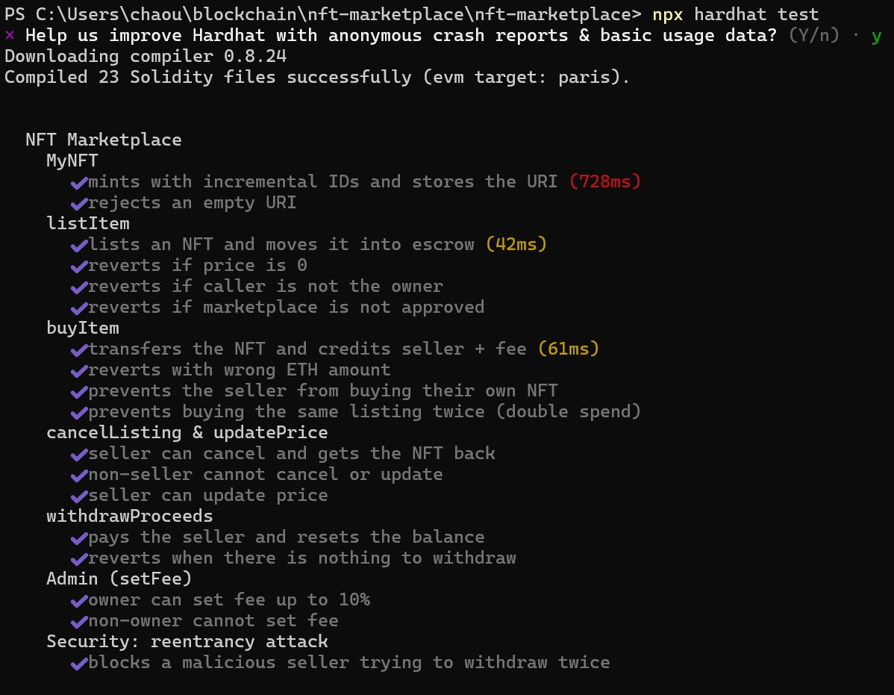
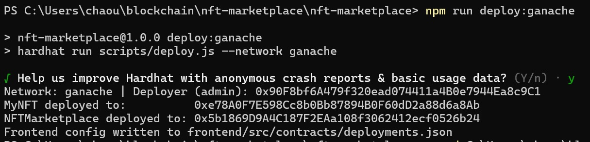
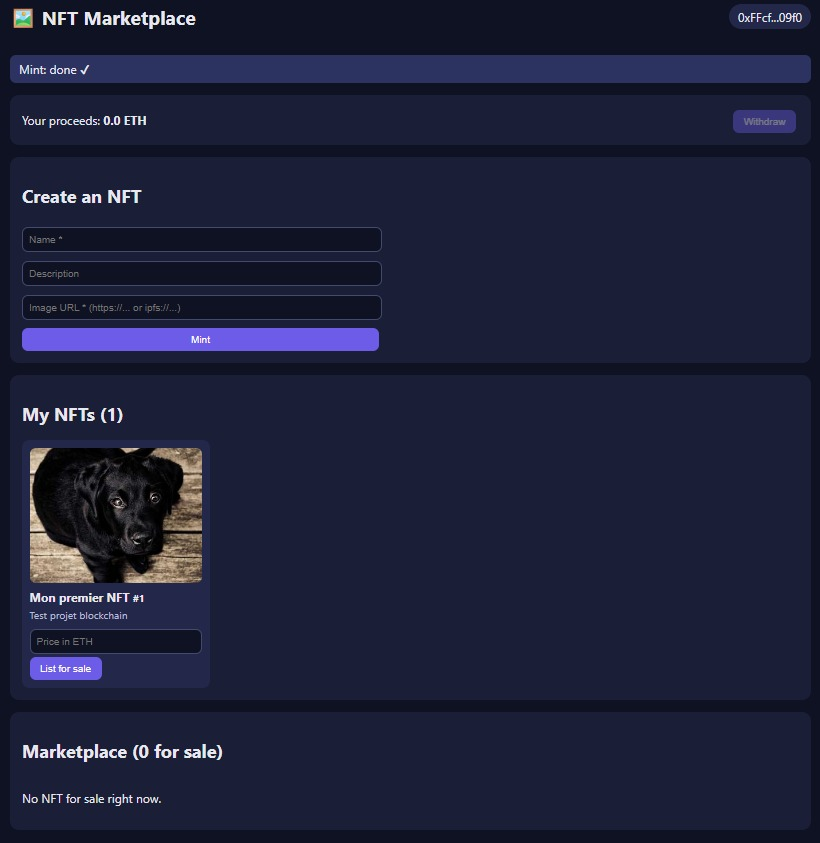
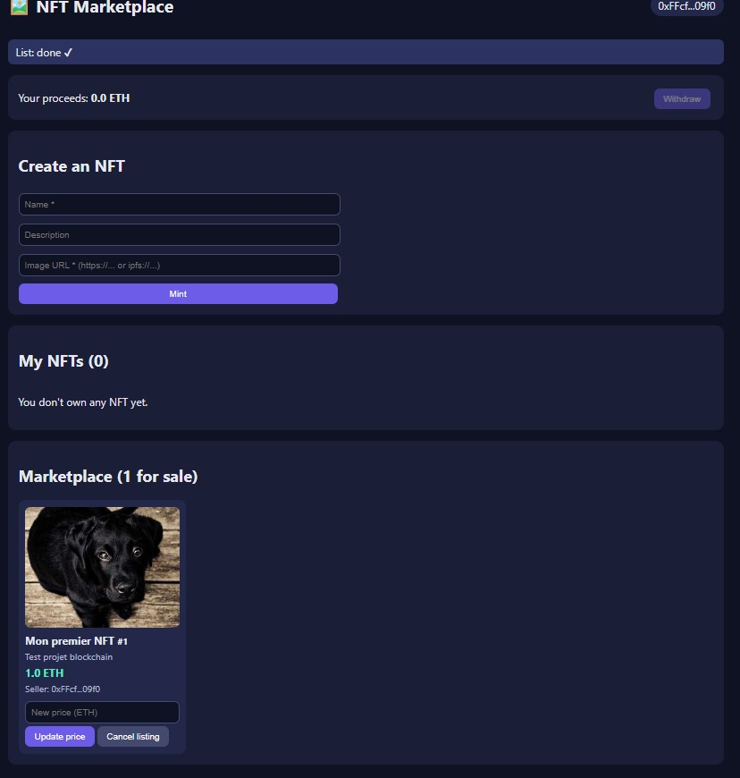
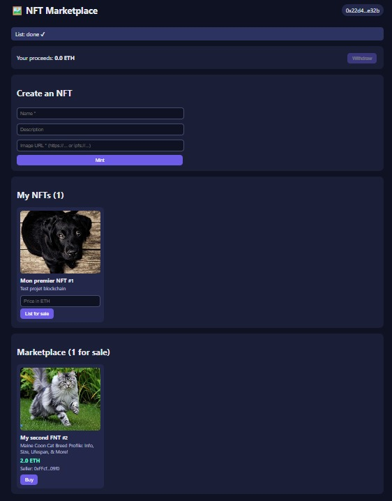
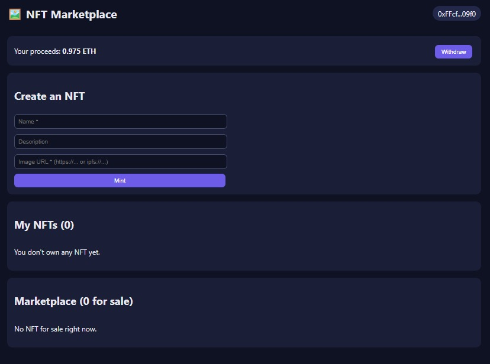

# Marketplace de NFT

Une marketplace décentralisée simple où les utilisateurs **créent (mint)** des NFT (ERC-721), les **mettent en vente**, les **achètent** en ETH, **annulent** ou **modifient le prix** de leurs annonces et **retirent** leurs gains. Un **administrateur** (propriétaire du contrat) fixe la commission de la plateforme (10 % maximum).

> Mini-projet, module Blockchain. Binôme : Yasmine Chaouachi & Zina Jellabi.

---

## 1. Pourquoi une blockchain ?

| Problème d'une marketplace centralisée | Apport de la blockchain |
|---|---|
| La plateforme peut bloquer, censurer ou falsifier la propriété | La propriété est publique et vérifiable (`ownerOf`) |
| L'acheteur doit faire confiance à la plateforme pour la livraison | Le smart contract échange NFT ↔ ETH de façon **atomique** (tout ou rien) |
| Commissions opaques | La commission est publique dans le contrat (`feeBps`) et plafonnée à 10 % dans le code |
| Paiement retenu par une entreprise | Le vendeur retire lui-même ses ETH (`withdrawProceeds`) |

**Plateforme :** Ethereum (EVM), la référence pour les NFT (standard ERC-721), avec des outils matures (Solidity, OpenZeppelin, MetaMask). Blockchain locale **Ganache** pour le développement : gratuite, instantanée, 10 comptes pré-approvisionnés.

---

## 2. Architecture

```
 React + Vite (frontend)  ──ethers.js──►  MetaMask (signe les tx)  ──►  Ganache (Ethereum local)
                                                                            │
                                                              ┌─────────────┴──────────────┐
                                                              │  MyNFT.sol (ERC-721)       │
                                                              │  NFTMarketplace.sol        │
                                                              └────────────────────────────┘
```

### Smart contracts

| Contrat | Rôle | Fonctions principales |
|---|---|---|
| `MyNFT.sol` | Collection ERC-721 (OpenZeppelin `ERC721URIStorage`) | `mint(uri)`, `totalMinted()`, + fonctions standard ERC-721 (`ownerOf`, `approve`, `tokenURI`…) |
| `NFTMarketplace.sol` | Logique de vente (séquestre + paiements « pull ») | `listItem`, `buyItem`, `cancelListing`, `updatePrice`, `withdrawProceeds`, `setFee` (admin), `getActiveListings` |
| `test/ReentrancyAttacker.sol` | **Tests uniquement** : contrat malveillant qui prouve la protection contre la réentrance | `attack()` |

### Déroulement d'une vente

1. Le vendeur appelle `mint` → il possède le token n° N.
2. Le vendeur appelle `approve(marketplace, N)` puis `listItem(nft, N, prix)` → le NFT est transféré à la marketplace (séquestre).
3. L'acheteur appelle `buyItem(listingId)` en envoyant exactement `prix` ETH → le NFT va à l'acheteur ; `prix − commission` est crédité au vendeur, la `commission` à l'admin.
4. Le vendeur appelle `withdrawProceeds()` → il reçoit ses ETH.

### Choix de conception

- **Séquestre (escrow)** : le NFT est détenu par le contrat pendant la mise en vente. Le vendeur ne peut donc pas le vendre ou le transférer ailleurs en même temps, ce qui évite les annonces « fantômes ».
- **Paiements « pull »** : les ETH ne sont pas envoyés au vendeur pendant `buyItem`. Ils sont stockés dans `proceeds` et retirés plus tard. Un vendeur incapable de recevoir des ETH ne peut pas bloquer les achats.
- **Métadonnées** : stockées sous forme d'URI `data:` (JSON avec nom, description et URL de l'image), pour éviter d'avoir besoin d'IPFS pendant la démo. Les URI `ipfs://` et `https://` fonctionnent aussi.

---

## 3. Sécurité

| Risque | Protection dans le code | Prouvé par le test |
|---|---|---|
| Réentrance (retirer deux fois) | `nonReentrant` (OpenZeppelin) + solde remis à 0 **avant** l'envoi des ETH (Checks-Effects-Interactions) | `Security: reentrancy attack` |
| Double vente du même NFT | `active = false` avant le transfert + modificateur `onlyActive` | `prevents buying the same listing twice` |
| Mauvais montant payé | `require(msg.value == price)` | `reverts with wrong ETH amount` |
| Un autre compte annule ou modifie le prix | Modificateur `onlySeller` | `non-seller cannot cancel or update` |
| Mettre en vente un NFT qu'on ne possède pas | Vérification `ownerOf == msg.sender` | `reverts if caller is not the owner` |
| Un non-admin modifie la commission | `onlyOwner` (OpenZeppelin `Ownable`) | `non-owner cannot set fee` |
| L'admin fixe une commission abusive | Plafond `MAX_FEE_BPS = 1000` (10 %) | `owner can set fee up to 10%` |
| Dépassement d'entier (overflow) | Solidity ≥ 0.8 annule automatiquement la transaction | — |

**Limites connues** (à aborder à l'oral) : `getActiveListings` et la boucle `ownerOf` du frontend sont en O(n), ce qui suffit pour une démo ; à grande échelle, il faudrait un indexeur (The Graph) ou exploiter les événements. Pas de royalties (ERC-2981), pas d'enchères, et les images ne sont pas stockées sur la blockchain (seul leur lien l'est).

---

## 4. Outils

| Outil | Utilisation dans le projet |
|---|---|
| Solidity 0.8.24 | Smart contracts |
| OpenZeppelin 5.1 | ERC-721, `Ownable`, `ReentrancyGuard` audités |
| Remix IDE | Écrire, compiler et déployer manuellement sur Ganache |
| Hardhat | Tests automatisés (18 tests) + script de déploiement |
| Ganache | Blockchain Ethereum locale (chainId 1337) |
| MetaMask | Portefeuille : passer d'un compte à l'autre (admin / vendeur / acheteur), signer les transactions |
| React + Vite | Frontend (tableau de bord, formulaire de création, marketplace, panneau admin) |
| Ethers.js v6 | Communication frontend ↔ contrats |
| Git / GitHub | Gestion de versions, travail en binôme |

---

## 5. Structure du projet

```
nft-marketplace/
├── contracts/
│   ├── MyNFT.sol
│   ├── NFTMarketplace.sol
│   └── test/ReentrancyAttacker.sol
├── test/NFTMarketplace.test.js      # 18 tests Hardhat
├── scripts/deploy.js                # déploie + écrit la config du frontend
├── hardhat.config.js
├── frontend/
│   └── src/
│       ├── App.jsx                  # état + portefeuille + rafraîchissement
│       ├── web3.js                  # fonctions utilitaires ethers
│       ├── contracts/deployments.json  # adresses + ABI
│       └── components/  MintForm, MyNFTs, Marketplace, AdminPanel, NFTCard
└── docs/
    ├── PROJECT_PROPOSAL.md          # les 3 idées demandées par le professeur
    ├── AI_USAGE.md                  # journal d'utilisation de l'IA (critère noté)
    ├── QA_PREP.md                   # préparation de la soutenance
    └── *.png                        # captures d'écran de la démo
```

---

## 6. Installation pas à pas

### Prérequis

- [Node.js](https://nodejs.org) 18+ avec **npm 10** (vérifier avec `node -v` et `npm -v` ; mettre npm à jour avec `npm install -g npm@10` si besoin)
- Git
- Ganache CLI : `npm install -g ganache`
- Extension navigateur [MetaMask](https://metamask.io)

### Étape 1 — Cloner et installer

```bash
git clone https://github.com/yassou123/nft-marketplace.git
cd nft-marketplace
npm install
cd frontend && npm install && cd ..
```

> ⚠ Lancez toutes les commandes depuis le dossier qui contient `hardhat.config.js`. Si `npx hardhat` propose d'installer `hardhat@3`, vous n'êtes pas dans le bon dossier → répondez **n**.

### Étape 2 — Lancer les tests

```bash
npx hardhat test        # s'exécute sur le réseau interne de Hardhat
npx hardhat coverage    # optionnel : rapport de couverture
```

Résultat attendu : `18 passing`.

### Étape 3 — Démarrer Ganache

Dans un **terminal séparé** (à laisser ouvert), depuis un dossier autre que `C:\Windows\system32` :

```bash
mkdir ganache-db
ganache --port 7545 --chain.chainId 1337 --wallet.deterministic --db ./ganache-db
```

- `--wallet.deterministic` : les mêmes 10 comptes à chaque lancement.
- `--db` : la blockchain est sauvegardée, les contrats sont conservés après un redémarrage.
- L'avertissement `µWS is not compatible` avec Node 22 n'est pas bloquant (Ganache bascule sur une implémentation Node.js).

Résultat attendu : `RPC Listening on 127.0.0.1:7545`.

### Étape 4 — Déployer les contrats

**Option A — Hardhat (recommandée, configuration automatique) :**

```bash
npm run deploy:ganache
```

Les adresses et les ABI sont écrites dans `frontend/src/contracts/deployments.json`.

**Option B — Remix + MetaMask (manuelle) :**

1. Ouvrir [remix.ethereum.org](https://remix.ethereum.org), créer `MyNFT.sol` et `NFTMarketplace.sol` (coller le code ; les imports OpenZeppelin sont résolus automatiquement).
2. *Solidity Compiler* → version `0.8.24` → **Advanced configurations → EVM version : `paris`** (⚠ Ganache ne supporte pas les instructions récentes de la version EVM par défaut) → Compile.
3. *Deploy & Run* → Environment **Injected Provider – MetaMask** (MetaMask sur Ganache, compte Admin).
4. Déployer `MyNFT`, puis `NFTMarketplace`.
5. Copier les deux adresses dans `frontend/src/contracts/deployments.json` (`"address": "0x..."`). Les ABI sont déjà dans le fichier.

### Étape 5 — Configurer MetaMask

1. **Importer le portefeuille Ganache** : *Importer un portefeuille existant* → coller la phrase de 12 mots affichée par Ganache (section `HD Wallet`).
   > ⚠ Cette phrase est publique (tests uniquement). N'y mettez jamais de vrais fonds. MetaMask peut découvrir automatiquement de nombreux comptes liés à cette phrase : c'est normal.
2. **Ajouter le réseau** : ☰ → *Réseaux* → *Ajouter un réseau personnalisé* : nom `Ganache`, RPC `http://127.0.0.1:7545`, ID de chaîne `1337`, symbole `ETH`. Puis sélectionner **Ganache** dans le filtre des réseaux.
3. **Trouver et renommer les 3 comptes** (recherche par adresse dans la liste des comptes) :

| Rôle | Index Ganache | Adresse |
|---|---|---|
| **Admin** (déployeur) | (0) | `0x90F8bf6A…8c9C1` |
| **Vendeur** | (1) | `0xFFcf8FDE…409f0` |
| **Acheteur** | (2) | `0x22d491Bd…1e32b` |

4. Lors d'un changement de compte, si MetaMask affiche *« localhost:5173 — Non connecté »*, cliquer sur **Connecter**, puis recharger la page.

### Étape 6 — Démarrer le frontend

```bash
cd frontend
npm run dev
```

Ouvrir http://localhost:5173 → **Connect MetaMask**.

### Étape 7 — Scénario de démonstration (pour la soutenance)

1. Compte **Vendeur** : créer un NFT (nom + URL d'image, par exemple `https://picsum.photos/id/237/300`) → *Mint*.
2. Saisir un prix (par exemple `1`) → *List for sale* → confirmer **2** transactions MetaMask (approve + list).
3. Passer MetaMask sur **Acheteur** → le NFT apparaît dans *Marketplace* → *Buy*.
4. L'acheteur le voit maintenant dans *My NFTs*.
5. Revenir sur **Vendeur** → *Your proceeds: 0.975 ETH* → *Withdraw*.
6. Passer sur **Admin** → panneau admin → gains = 0,025 ETH de commission ; changer la commission à `5` %.
7. Montrer un cas d'échec : le vendeur essaie d'acheter son propre NFT → message d'erreur.

> Toujours vérifier **« Signer avec »** et **« Réseau : Ganache »** dans la fenêtre MetaMask avant de confirmer.

---

## Captures d'écran de la démo

| Tests | Déploiement |
|---|---|
|  |  |

| Création (mint) | Mise en vente |
|---|---|
|  |  |

| Achat | Gains du vendeur |
|---|---|
|  |  |

---

## 7. Organisation GitHub (travail en binôme)

- Dépôt : https://github.com/yassou123/nft-marketplace
- Répartition : **Yasmine Chaouachi** = smart contracts + tests, **Zina Jellabi** = frontend + documentation.
- Une branche par fonctionnalité (`feature/contracts`, `feature/frontend`) → Pull Request → relecture par l'autre membre du binôme → fusion.
- Commits réguliers avec des messages clairs.

---

## 8. Améliorations possibles

Royalties (ERC-2981), enchères, envoi des images sur IPFS (Pinata), indexation par les événements (The Graph), déploiement sur le testnet Sepolia, filtres et recherche dans la collection.
